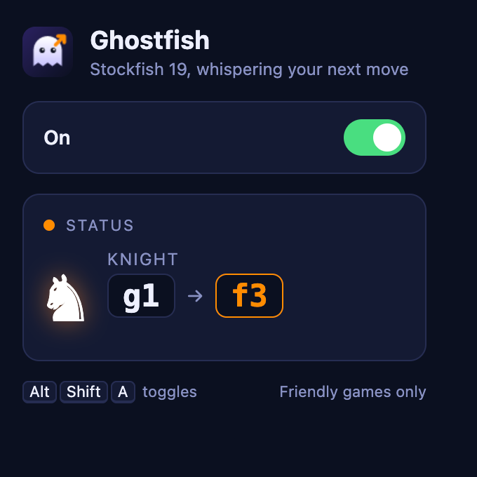
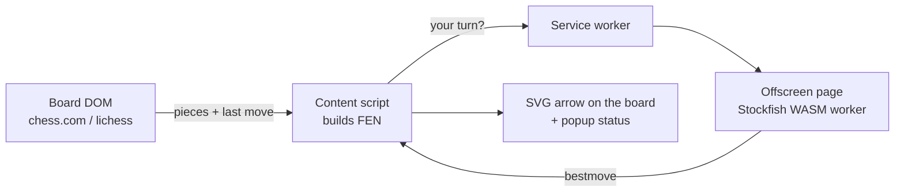

<div align="center">


# Ghostfish

**A whisper-quiet Stockfish arrow for chess.com and lichess.org.**
Your best move, drawn right on the board.




</div>

## What it does

Open a game, switch Ghostfish on, and on **your turn** it draws an orange arrow for the best move.
The popup spells it out too: *Knight g1 → f3*, plus whether it captures or castles.

- **Two sites:** chess.com and lichess.org (games, analysis boards, vs. computer).
- **Real Stockfish:** the official engine, compiled to WebAssembly (Stockfish 19, lite NNUE build).
- **Private:** the engine runs inside your browser. No server, no account, no network calls.
- **Any Chromium browser:** Chrome, Brave, Edge, Arc.
- **Plays your side:** it follows the board orientation, so it works whether you're White or Black, and stays quiet on your opponent's turn.

## Install

1. Download or clone this repo.
2. Open `chrome://extensions` (or `brave://extensions`) and enable **Developer mode**.
3. Click **Load unpacked** and select the [`extension/`](extension) folder.
4. Refresh any open chess.com / lichess tabs.

## Use

| Action | How |
|---|---|
| Turn on / off | Click the Ghostfish icon and flip the switch, or press `Alt` `Shift` `A` |
| See the move | Orange arrow on the board, move spelled out in the popup |
| Change the shortcut | `chrome://extensions/shortcuts` |

Popup status lines: **Your move** · **Thinking…** · **Waiting for opponent** · **No board found** · **Engine error**.

## How it works



1. A `MutationObserver` watches the board and waits for it to settle (150 ms).
2. A site-specific reader turns the DOM into piece positions, the last move and your colour.
3. A FEN is built (side to move from the last mover, en passant from double pawn pushes).
4. If it's your turn, the FEN goes to Stockfish (1 second of thinking) and the answer is drawn as an arrow.
5. Any further board change clears the arrow, and stale engine answers are thrown away.

## Fair play

Ghostfish is for **friendly games, analysis and harmless pranks**. Using engine help in rated or competitive games breaks
the rules of chess.com and lichess, can get accounts banned, and ruins the game for the other person. Don't. If you
use it on a friend, tell them afterwards.

## Known limits

- **Castling rights are inferred** from king/rook home squares. Wrong if they moved away and came back (rare).
- **Site updates can break the readers** in [`extension/content/readers/`](extension/content/readers). Selectors were verified on live pages on 2026-10-27; PRs welcome.
- **Fixed 1 s think time.** Change `MOVETIME_MS` in [`extension/offscreen.js`](extension/offscreen.js).
- **Lite engine.** Still far above human strength, but not the full 94 MB network.

## Development

```bash
npm install
npm test        # FEN builder, both board readers, overlay, engine, content-script integration
npm run icons   # re-render extension/icons/*.png from icon.svg
```

```
extension/
  manifest.json
  background.js        toggle state, badge, relays requests to the engine
  offscreen.{html,js}  hosts the Stockfish worker (latest request wins)
  popup.{html,css,js}  the UI
  content/
    fen.js             pure FEN builder
    readers/           chesscom.js, lichess.js: DOM -> position
    overlay.js         SVG arrow
    main.js            observer, debounce, glue
  engine/              stockfish-19-lite-single (.js + .wasm)
tests/                 node:test + jsdom
```

## Credits and license

- [Stockfish](https://github.com/official-stockfish/Stockfish) by the Stockfish developers.
- [stockfish.js](https://github.com/nmrugg/stockfish.js) by Nathan Rugg, the WebAssembly build bundled in `extension/engine/`.

Both are GPL-3.0, so Ghostfish is too. See [LICENSE](LICENSE).
