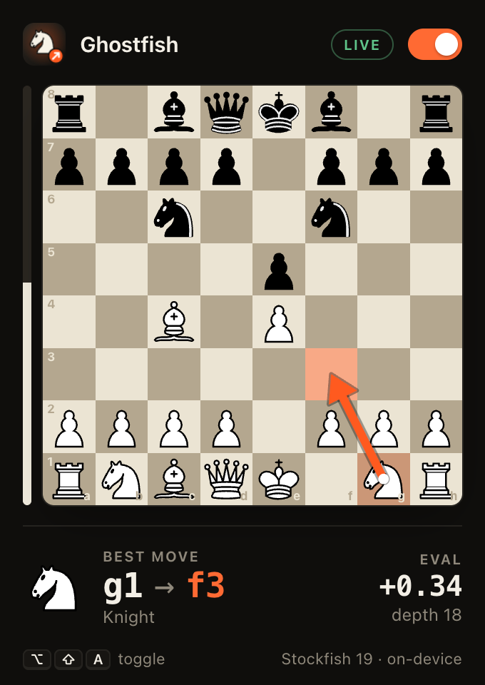
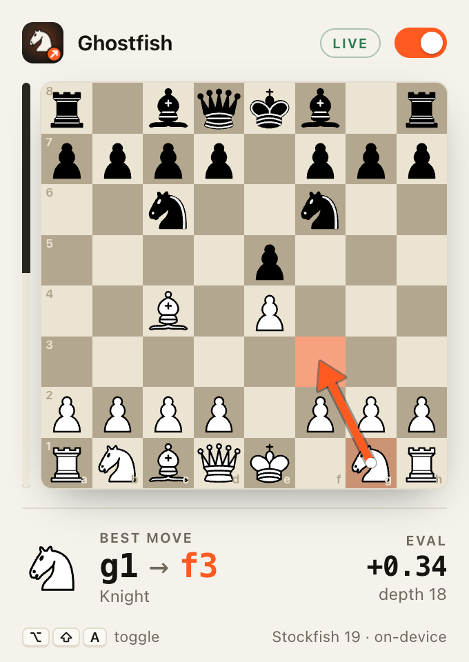

<div align="center">


# Ghostfish

### Beat your best friend at chess. Just once.

A tiny browser extension that whispers Stockfish's best move onto your board.<br>
One orange arrow. That's the whole product.

<br>

 &nbsp; 

</div>

<br>

## How it works

1. It watches the board.
2. It waits for **your** turn. (Opponent thinking? It sulks quietly.)
3. It asks Stockfish 19, running inside your browser, what you'd play if you were smarter.
4. It draws the answer. Knights get an L, because knights have to be special.

No server. No account. Nothing leaves your machine.

## Get it in 30 seconds

1. `git clone https://github.com/KirtanUgreja/ghostfish`
2. Open `chrome://extensions` (or `brave://extensions`), turn on **Developer mode**, click **Load unpacked**, pick the `extension/` folder.
3. Refresh your chess tab. Flip the switch, or press `Alt`+`Shift`+`A`.

Works on **chess.com** and **lichess.org**, in any Chromium browser (Chrome, Brave, Edge...). Tested on Brave.

## Be a good person about it

Use it on friends who will laugh. Not in rated games, not in tournaments, not on strangers: the sites will ban you, and honestly, they should.

And when you win, **confess**. Friendship is a long game.

<br>

<details>
<summary><b>Nerd corner</b></summary>

<br>

```
board DOM  →  FEN  →  Stockfish (WASM, 1 s)  →  arrow + popup
```

- The popup also shows Stockfish's eval and depth (`+0.34`, `#3` for forced mate).
- **Quirks:** castling rights are guessed from king/rook home squares. If a site changes its HTML, the readers in `extension/content/readers/` may need a nudge. Think time is `MOVETIME_MS` in `extension/offscreen.js`.
- **Hack on it:** `npm install && npm test` (33 tests: FEN builder, both board readers, engine, content script).

</details>

<br>

<div align="center">

<sub>Built on [Stockfish](https://github.com/official-stockfish/Stockfish) · [stockfish.js](https://github.com/nmrugg/stockfish.js) · pieces by [Colin M. L. Burnett](https://en.wikipedia.org/wiki/User:Cburnett) · GPL-3.0</sub>

</div>
